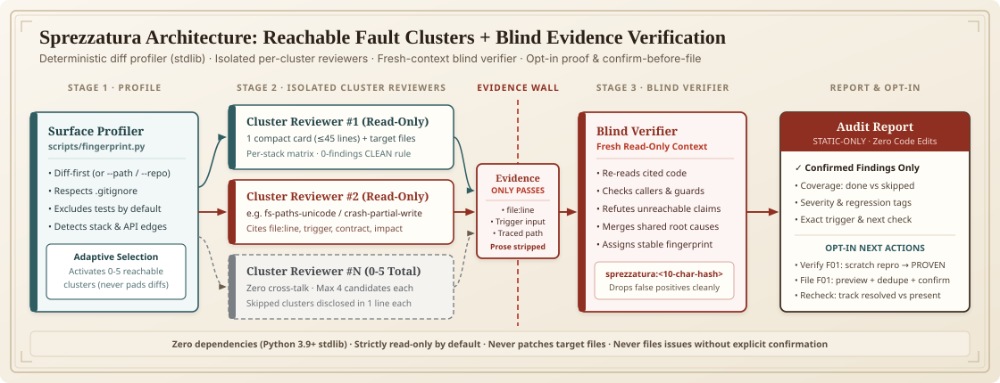

<div align="center">

<p align="center">
  
  &nbsp;&nbsp;
  
  &nbsp;&nbsp;
  
</p>

# ⚖️ Sprezzatura (스프레짜투라)

### *내 PC에서는 통과한 테스트. 남의 환경에서 터질 버그를 머지·배포 전에 먼저 잡는다.*

<p>
  <a href="./README.md">English</a> · <a href="./README.ko.md"><strong>한국어</strong></a>
</p>

<p>
  
  
  
  
</p>

> *'스프레짜투라(Sprezzatura, 발다사레 카스틸리오네, 1528)' — 겉으로는 힘들이지 않은 자연스러움, 보이지 않는 바닥에는 빈틈없는 엄밀함. 이 도구는 그 보이지 않는 엄밀함을 맡습니다.*
>
> **Sprezzatura**(`/sprezzatura`, `/spz`)는 **Claude Code**, **Antigravity**, **Codex CLI**를 위한 의존성 0의 읽기 전용 QA 감사 스킬입니다 — **대상 파일 수정 0건, 사용자 확인 없는 이슈 등록 0건.**

</div>

---

## 🔥 문제의식: 내 머신의 테스트는 통과해도, 실제 환경은 다르게 깨진다

로컬 테스트는 내 시간대, 내 로캘, 내 파일시스템, 정상적인 네트워크 응답 위에서 돌아갑니다. 하지만 실제 운영 환경은 그렇지 않습니다:
- 대소문자 변환이나 소수점 쉼표가 파싱을 깨뜨리는 비영미권 로캘
- 서머타임(DST) 전환, 시스템 시계 점프, 노트북 절전 복귀 직후의 시간 튐
- 공백·한글·이모지가 섞인 경로, Windows CP949/cp1252 인코딩, 읽기 전용 설치 폴더
- 파일 기록 도중 프로세스가 강제 종료되어 남는 깨진 상태 파일과 좀비 락
- 더블클릭이나 네트워크 재시도로 같은 요청이 두 번, 순서가 뒤집혀 도착하는 상황

LLM에게 막연히 *"이 diff에서 엣지 케이스 좀 봐줘"*라고 시키면 표면적인 체크리스트와 스타일 지적, 근거 없는 오탐만 돌아옵니다. 반대로 30개 규칙을 한 프롬프트에 몰아넣으면 주의가 분산되어 정작 치명적인 결함을 놓칩니다.

---

## 🏛️ Sprezzatura 작동 원리: 도달 가능한 클러스터 + 블라인드 증거 검증

Sprezzatura는 결정론적 프로파일러로 실제 도달 가능한 결함 범주만 선별하고, 각 클러스터를 격리된 서브에이전트로 검토한 뒤, **설명 문장을 벗겨낸 증거 레코드만 보는 독립 검증자**를 거쳐 확인된 결함만 보고합니다:

<p align="center">
  
</p>

1. **Stage 1 — 결정론적 표면 프로파일러 (`scripts/fingerprint.py`):**
   - Python 표준 라이브러리 전용 스캐너가 `.gitignore`를 준수하고, 기본 설정에서 테스트 파일을 운영 점수 산정에서 제외(`--include-tests`로 선택 포함)하며 스택·OS·API 경계 신호를 추출합니다.
   - 실제 도달 가능한 **0~5개 클러스터만 적응형으로 활성화**(작은 diff에 억지로 채우지 않음)하고, 스킵된 클러스터와 1줄 사유를 함께 공개합니다.
2. **Stage 2 — 클러스터별 격리 검토자 *(읽기 전용 · 무교신)*:**
   - 활성 클러스터마다 깨끗한 읽기 전용 서브에이전트 1개를 띄워 `tools/lint_cards.py`로 검증된 초압축 카드(`<=45`줄, `<=250`단어) 1장만 전달합니다.
   - 각 카드에는 **스택별 적용 매트릭스**(예: 로캘 독립적인 Python `str.lower()`를 터키어 대소문자 버그로 오탐하는 실수 차단), `3~5`개 시드 프로브, 반증 규칙, `0 findings (CLEAN)` 규칙이 들어 있습니다.
   - 문제 보고 전용: 모든 후보에는 `file:line`, `symbol`, 트리거 입력, 깨지는 계약, 추적 경로, 사용자 영향이 반드시 붙으며 임의 코드 패치를 쓰지 않습니다.
3. **Stage 3 — 새 컨텍스트 블라인드 검증자 *(증거 장벽)*:**
   - 앞선 검토자의 서술·설득 문구·확신도 점수를 전부 벗겨내고 **정규화된 증거 레코드만** 받습니다.
   - 인용된 코드와 호출부·가드 조건을 직접 다시 읽어 도달 불가능하거나 계약을 지키는 주장을 기각하고, 동일 근본 원인을 병합한 뒤 안정적인 지문(`sprezzatura:<10-char-hash>`)을 부여합니다.
4. **Stage 3.5 — 선택적 실행 증명(`--prove`) & 확인 후 이슈 등록:**
   - 기본 보고는 `STATIC-ONLY`입니다. `--prove`를 주거나 `Verify F01`로 답하면 임시 격리 공간에서 실제 제품 진입점과 정상 대조군을 실행해 `PROVEN` / `REPRO-FAILED`를 판정합니다(Unity/GUI 같은 대형 빌드는 `STATIC-ONLY` 유지).
   - `File F01`로 답하면 이슈 초안을 먼저 미리 보여주고 `gh issue list --search "sprezzatura:<fp>"`로 중복을 점검하며, 사용자가 명시 승인하기 전에는 절대 생성하지 않습니다.

---

## ⚡ 왜 일반 코드 리뷰 프롬프트보다 격리 클러스터 감사가 나은가

| 방식 | 검토자가 보는 입력 | 흔한 한계 |
|---|---|---|
| **일반 diff 리뷰** (*"엣지 케이스 찾아줘"*) | 전체 diff + 막연한 지시 | 스타일 지적, 모호한 경고, OS·로캘·크래시 경계 누락 |
| **단일 스레드 30항목 체크리스트** | 모든 결함 규칙을 한 컨텍스트에 투입 | 앵커 오염, 후반 규칙 누락, 스택 간 오탐 폭주 |
| **Sprezzatura** *(프로파일러 → 격리 클러스터 → 블라인드 검증자)* | 도달 가능한 카드 1장씩 독립 배정 후 서술을 벗긴 증거 레코드만 교차 검증 | 반증에 실패한 실제 `file:line` 결함 경로만 추려서 전달 |

---

## 🔍 점검 대상 (12종 결함 클러스터)

[`skill/sprezzatura/references/clusters/`](./skill/sprezzatura/references/clusters/)의 12개 카드는 `tools/lint_cards.py`로 길이(`<=45`줄, `<=250`단어), 시드 프로브(`3~5`개), 스택별 적용성, 반증 규칙을 강제합니다.

| # | 클러스터 ID | 범주 | 핵심 점검 대상 | 카드 |
|---:|---|---|---|---|
| 01 | `locale-casing` | `i18n` | 로캘 민감 대소문자 변환(터키어 `i`/`İ`, `I`/`ı`) 및 조회 | [01_locale_casing.md](./skill/sprezzatura/references/clusters/01_locale_casing.md) |
| 02 | `locale-format` | `i18n` | 소수점 쉼표, 날짜 순서, 통화 정밀도 | [02_locale_format.md](./skill/sprezzatura/references/clusters/02_locale_format.md) |
| 03 | `clock-dst-sleep` | `time` | DST 공백/중복, 시스템 시계 점프, 절전 복귀 시간 튐 | [03_clock_dst_sleep.md](./skill/sprezzatura/references/clusters/03_clock_dst_sleep.md) |
| 04 | `fs-paths-unicode` | `filesystem` | 공백·비ASCII·이모지 경로, Windows CP949/cp1252, 대소문자 구분 | [04_fs_paths_unicode.md](./skill/sprezzatura/references/clusters/04_fs_paths_unicode.md) |
| 05 | `crash-partial-write` | `durability` | 기록 중 `SIGKILL`/`ENOSPC`, 잘린 파일, 좀비 락 파일 | [05_crash_partial_write.md](./skill/sprezzatura/references/clusters/05_crash_partial_write.md) |
| 06 | `concurrency-idempotency` | `concurrency` | 더블클릭 레이스, 역순 응답, 비멱등 재시도 | [06_concurrency_idempotency.md](./skill/sprezzatura/references/clusters/06_concurrency_idempotency.md) |
| 07 | `numeric-boundary` | `numeric` | `0`, `NaN`/`Inf`, falsy 강제 변환, `fp16`/부동소수점 드리프트 | [07_numeric_boundary.md](./skill/sprezzatura/references/clusters/07_numeric_boundary.md) |
| 08 | `wire-serialization` | `serialization` | 스키마 드리프트, 1원소 배열 언래핑, 알 수 없는 enum | [08_wire_serialization.md](./skill/sprezzatura/references/clusters/08_wire_serialization.md) |
| 09 | `network-hostile` | `network` | 타임아웃 누락, 반개방 소켓, 재시도 폭주 | [09_network_hostile.md](./skill/sprezzatura/references/clusters/09_network_hostile.md) |
| 10 | `resource-scale-lifetime` | `lifecycle` | 빈 입력/100× 스케일 절벽, 72시간 핸들·타이머 누수 | [10_resource_scale_lifetime.md](./skill/sprezzatura/references/clusters/10_resource_scale_lifetime.md) |
| 11 | `auth-trust-boundary` | `security` | IDOR, 경로 이탈, SQL/셸 경계 우회, 시크릿 로그 노출 | [11_auth_trust_boundary.md](./skill/sprezzatura/references/clusters/11_auth_trust_boundary.md) |
| 12 | `cold-start-migration` | `lifecycle` | 첫 실행 빈 상태, 스키마 업그레이드, 읽기 전용 설치 경로 | [12_cold_start_migration.md](./skill/sprezzatura/references/clusters/12_cold_start_migration.md) |

---

## 📄 리포트 읽는 법

리포트는 완료·스킵·타임아웃 범위를 명확히 구분한 요약으로 시작해, 확정된 결함과 선택형 후속 액션 순으로 정리됩니다:

```text
Impact: <count + user-visible consequence>; checks <done>/<selected>; unfinished <count>
Evidence: <STATIC-ONLY | PROVEN>; revision <sha>; <raw> -> <confirmed>
Next: <smallest concrete next check>
Coverage: <skipped or timed-out clusters and 1-line reasons>

F01 | <Blocker | Major | Watch> | <STATIC-ONLY | PROVEN | REPRO-FAILED> | <regression | pre-existing>
Location: <file:line> (<symbol>) | Fingerprint: sprezzatura:<10-char-hash>
Trigger: <concrete input> | Contract: <expected behavior>
Impact: <user-visible failure> | Next check: <verification step>

Actions: Verify F01 | File F01 | Recheck
```

---

## 🎯 언제 쓰면 좋은가

- **PR 머지나 릴리스 직전** — 파일 I/O, 파싱, 직렬화, 권한 경계, 재시도, 날짜·로캘 처리가 포함된 변경 사항 점검 시.
- **OS·로캘 경계를 넘어 배포할 때** — Windows/Linux 경로, 공백·유니코드 파일명, 소수점 쉼표·대소문자, DST·모노토닉 클럭 전제가 걸린 코드.
- **상태 전이 로직 배포 전** — 스키마 마이그레이션, 첫 실행 초기화, 락 파일, 원자적 쓰기 및 크래시 복구 경로.
- **낯선 모듈을 처음 인수했을 때** (`--path src/billing`) — 임의 패치 없이 읽기 전용으로 위험 지점만 훑고 싶을 때.

Sprezzatura는 단위 테스트·린터·SAST를 대체하지 않고 그 빈틈을 보완합니다. 코드 스타일·네이밍·일반 PR 코멘트는 범위 밖입니다.

---

## 🚀 설치 및 사용법 (외부 의존성 0 · Python 3.9+ 표준 라이브러리)

Python 3.9+(표준 라이브러리만 사용)와 **Claude Code**, **Antigravity (`agy`)**, **Codex CLI** 중 하나가 필요합니다.

### 1. 설치

**Claude Code**에서는 한 줄로 바로 설치하거나, 저장소를 클론해 로컬 설치 스크립트를 실행할 수 있습니다(`--dry-run` 미리보기, 깔끔한 재설치, Antigravity용 `plugin.json` 자동 생성 지원):

```bash
# Claude Code 원스텝 마켓플레이스 설치 (v2.1.275+)
/plugin install sprezzatura --marketplace Excelsus4/sprezzatura
```

```bash
git clone https://github.com/Excelsus4/sprezzatura.git && cd sprezzatura

# macOS / Linux / Git Bash
bash tools/install.sh --dry-run
bash tools/install.sh --target claude                # claude | agy | codex | all | auto
bash tools/install.sh --target agy --agy-mode plugin # agy 기본값 (또는 --agy-mode skill)
```

```powershell
# Windows PowerShell 5.1+ / PowerShell 7
powershell -ExecutionPolicy Bypass -File tools\install.ps1 -DryRun
powershell -ExecutionPolicy Bypass -File tools\install.ps1 -Target all
```

<details>
<summary>수동 복사 설치 (인스톨러 미사용)</summary>

`cp -r` 실행 시 `sprezzatura/sprezzatura`로 중첩되지 않도록 기존 폴더가 있다면 먼저 지우고 복사합니다.

```bash
# Claude Code (+ /sprezzatura, /spz 슬래시 커맨드)
mkdir -p ~/.claude/skills ~/.claude/commands
rm -rf ~/.claude/skills/sprezzatura
cp -r skill/sprezzatura ~/.claude/skills/sprezzatura
cp commands/*.md ~/.claude/commands/

# Antigravity (agy) — skill 모드 (네이티브 plugin 모드는 tools/install.* 사용)
mkdir -p ~/.gemini/config/skills
rm -rf ~/.gemini/config/skills/sprezzatura
cp -r skill/sprezzatura ~/.gemini/config/skills/sprezzatura

# Codex CLI
mkdir -p ~/.codex/skills
rm -rf ~/.codex/skills/sprezzatura
cp -r skill/sprezzatura ~/.codex/skills/sprezzatura
```

</details>

### 2. 감사할 대상 저장소에서 실행

클론한 `sprezzatura` 폴더가 아니라 **감사하려는 프로젝트 저장소**(`cd /path/to/your-project`)에서 에이전트를 열어 호출합니다:

```text
/sprezzatura                              # 자동 범위 (워킹 diff -> merge-base)
/spz src/payments --mode standard       # 특정 모듈 지정 감사
/spz --mode deep --prove                # 최대 5개 클러스터 + 선택적 격리 재현 증명
/spz --repo --mode deep                 # 전체 저장소 감사 (예산 사전 확인)
```

| 모드 | 활성 클러스터 | 검증 | 적합한 상황 |
|---|---:|---|---|
| `quick` | `0–1` | 블라인드 검증자 1 | 작은 diff 또는 단일 위험 축 빠른 확인 |
| `standard` *(기본)* | 적응형 `0–3` | 블라인드 검증자 1 | 일상적인 PR·커밋 감사 (목표 ≤5 컨텍스트) |
| `deep` | `0–5` | 블라인드 검증자 1 + 선택 `--prove` | 릴리스·마일스톤 직전 정밀 감사 |

diff가 없는 클린 기본 브랜치에서는 저장소 전체를 임의로 스캔하지 않고 멈춘 뒤 `--path` 지정 또는 명시적 `--repo` 확인을 요청합니다.

### 로컬 검증 (개발용)

```bash
python3 tools/lint_cards.py
python3 -m unittest tools/test_tools.py -v
python3 skill/sprezzatura/scripts/fingerprint.py --repo . --scope repo
```

---

## 🧩 르네상스 크래프트 3부작 & 라이선스

Sprezzatura는 컨텍스트 격리로 AI 에이전트의 구조적 한계를 푸는 **의존성 0 에이전트 스킬 3부작**의 사후 QA 단계입니다:

| 도구 | 단계 | 격리 축 | 역할 |
|---|---|---|---|
| **[Sinopia](https://github.com/Excelsus4/sinopia)** | **착수 전** | 수직 *(레지스터 격리)* | 일상어 상담 + 정제된 브리프의 격리 시니어 검토 |
| **[Sfumato](https://github.com/Excelsus4/sfumato)** | **아이디어 발산** | 수평 *(도메인 격리)* | LLM 획일화를 깨는 듀얼 트랙 크로스도메인 탐색 |
| **Sprezzatura** *(현재 저장소)* | **사후 QA** | 클러스터 *(증거 격리)* | 로컬 테스트를 통과하는 환경·경계 결함 읽기 전용 감사 |

[MIT 라이선스](./LICENSE)로 배포됩니다.

---

<div align="center">


*“진정한 기예는 애쓴 티가 나지 않는 것이다.” — 발다사레 카스틸리오네, 《궁정인》(1528)*

<sub>본 문서에 사용된 모든 르네상스 도판과 사본 이미지는 Wikimedia Commons 퍼블릭 도메인입니다.</sub>

</div>
