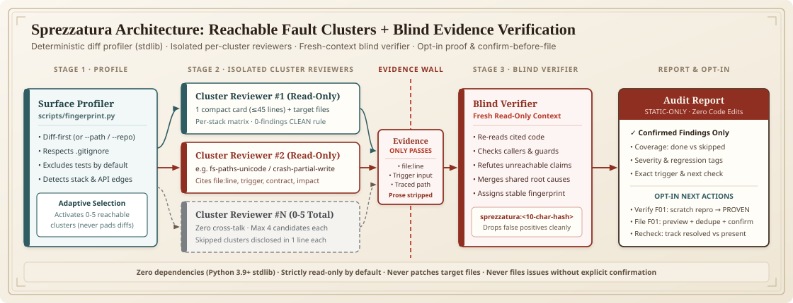

<div align="center">

<p align="center">
  
  &nbsp;&nbsp;
  
  &nbsp;&nbsp;
  
</p>

# ⚖️ Sprezzatura

### *Your tests pass on your machine. Catch what breaks on someone else's — before you merge or ship.*

<p>
  <a href="./README.md"><strong>English</strong></a> · <a href="./README.ko.md">한국어</a>
</p>

<p>
  
  
  
  
</p>

> *"Sprezzatura" (Baldassare Castiglione, Il Libro del Cortegiano, 1528) — studied nonchalance: effortless ease on the surface, invisible rigor underneath. This tool is the rigor underneath.*
>
> **Sprezzatura** (`/sprezzatura`, `/spz`) is a zero-dependency, read-only QA audit skill for **Claude Code**, **Antigravity**, and **Codex CLI** — **never edits target files, never files issues without confirmation.**

</div>

---

## 🔥 The Problem: Local Tests Pass While Real Environments Break

Your test suite runs on a clean machine in your timezone, your locale, your filesystem, and on happy-path network responses. Production runs everywhere else:
- A Turkish or European locale where casing or decimal commas break parsing
- A DST jump, wall-clock adjustment, or laptop sleep spike
- A Windows or Unicode path with spaces, non-ASCII characters, or read-only permissions
- A process killed mid-write leaving truncated state or zombie lock files
- A double-click or retry arriving twice out of order

Ask an LLM generically to *"review this diff for edge cases"* and you get shallow box-ticking, style nitpicks, and speculative false positives. Stuff 30 edge-case checklists into a single prompt and attention collapses into noise.

---

## 🏛️ How Sprezzatura Works: Reachable Clusters + Blind Evidence Verification

Sprezzatura profiles reachability deterministically, runs isolated per-cluster checks only for failure classes your code can actually hit, and filters every candidate through a fresh-context blind verifier before anything reaches your screen:

<p align="center">
  
</p>

1. **Stage 1 — Deterministic Surface Profiler (`scripts/fingerprint.py`):**
   - Pure-stdlib Python scanner respects `.gitignore`, excludes test harnesses from production cluster scoring by default (`--include-tests` opt-in), and detects stack, OS/runtime, and API boundary signals.
   - Adaptively activates **0–5 genuinely reachable clusters** (never padding a small diff), binds each to exact target files, and discloses skipped clusters in 1 line each.
2. **Stage 2 — Isolated Per-Cluster Reviewers *(Read-Only, Zero Cross-Talk)*:**
   - Spawns one clean-context read-only subagent per active cluster with a single compact card (`<=45` lines, `<=250` words) lint-enforced by `tools/lint_cards.py`.
   - Every card carries a **Per-Stack Applicability Matrix** (killing cross-stack false positives such as flagging Python `str.lower()` under Turkish casing), `3–5` concrete seed probes, a disproof rule, and an explicit `0 findings (CLEAN)` rule.
   - Problem-only output: every candidate cites `file:line`, `symbol`, trigger input, broken contract, traced path, and user impact (zero unsolicited code patches).
3. **Stage 3 — Fresh-Context Blind Verifier *(Evidence Wall)*:**
   - Receives **only** normalized evidence records — reviewer prose, persuasion, and confidence scores are stripped.
   - Re-reads cited code, callers, and guards to refute unreachable or contract-compliant claims, merges shared root causes, and assigns stable fingerprints (`sprezzatura:<10-char-hash>`).
4. **Stage 3.5 — Opt-In Execution Proof & Confirm-Before-File:**
   - Default findings stay `STATIC-ONLY`. Passing `--prove` or replying `Verify F01` runs an isolated scratch check through the real product entry point plus a passing control (`PROVEN` or `REPRO-FAILED`; heavy GUI/engine builds stay `STATIC-ONLY`).
   - Replying `File F01` previews the exact draft and checks `gh issue list --search "sprezzatura:<fp>"` for duplicates; nothing is created until you explicitly confirm.

---

## ⚡ Why Isolated Fault Clusters Beat Generic Review Prompts

| Approach | What the Reviewer Sees | Typical Failure Mode |
|---|---|---|
| **Generic diff review** (*"check for edge cases"*) | Entire diff + open-ended prompt | Style nitpicks, vague warnings, and missed OS/locale/crash boundaries |
| **Monolithic 30-item checklist** *(single thread)* | Every failure rule crammed into one context | Anchor bleed, tail compression, and cross-stack false positives |
| **Sprezzatura** *(Profiler → Isolated Clusters → Blind Verifier)* | Only reachable cluster cards (1 per subagent), followed by prose-stripped evidence records | Concrete `file:line` failure paths with refuted noise removed before reaching your screen |

---

## 🔍 What It Checks (12 Fault Clusters)

Each cluster card in [`skill/sprezzatura/references/clusters/`](./skill/sprezzatura/references/clusters/) is lint-enforced by `tools/lint_cards.py` to stay `<=45` lines and `<=250` words with `3–5` concrete seed probes, per-stack applicability rules, and an explicit disproof rule.

| # | Cluster ID | Category | Focus | Card |
|---:|---|---|---|---|
| 01 | `locale-casing` | `i18n` | Culture-sensitive casing (e.g., Turkish `i`/`İ`, `I`/`ı`) & lookup | [01_locale_casing.md](./skill/sprezzatura/references/clusters/01_locale_casing.md) |
| 02 | `locale-format` | `i18n` | Decimal comma, date order, currency precision | [02_locale_format.md](./skill/sprezzatura/references/clusters/02_locale_format.md) |
| 03 | `clock-dst-sleep` | `time` | DST gaps/ambiguity, wall-clock jumps, laptop sleep spikes | [03_clock_dst_sleep.md](./skill/sprezzatura/references/clusters/03_clock_dst_sleep.md) |
| 04 | `fs-paths-unicode` | `filesystem` | Spaces/non-ASCII/emoji paths, Windows CP949/cp1252, case sensitivity | [04_fs_paths_unicode.md](./skill/sprezzatura/references/clusters/04_fs_paths_unicode.md) |
| 05 | `crash-partial-write` | `durability` | Mid-flight `SIGKILL`/`ENOSPC`, truncated files, zombie locks | [05_crash_partial_write.md](./skill/sprezzatura/references/clusters/05_crash_partial_write.md) |
| 06 | `concurrency-idempotency` | `concurrency` | Double-click races, out-of-order responses, non-idempotent retries | [06_concurrency_idempotency.md](./skill/sprezzatura/references/clusters/06_concurrency_idempotency.md) |
| 07 | `numeric-boundary` | `numeric` | Zero, `NaN`/`Inf`, falsy coercion, `fp16`/float drift | [07_numeric_boundary.md](./skill/sprezzatura/references/clusters/07_numeric_boundary.md) |
| 08 | `wire-serialization` | `serialization` | Schema drift, single-item array unwrapping, unknown enums | [08_wire_serialization.md](./skill/sprezzatura/references/clusters/08_wire_serialization.md) |
| 09 | `network-hostile` | `network` | Missing timeouts, half-open sockets, retry storms | [09_network_hostile.md](./skill/sprezzatura/references/clusters/09_network_hostile.md) |
| 10 | `resource-scale-lifetime` | `lifecycle` | Empty/100× scale cliffs, 72-hour handle/timer leaks | [10_resource_scale_lifetime.md](./skill/sprezzatura/references/clusters/10_resource_scale_lifetime.md) |
| 11 | `auth-trust-boundary` | `security` | IDOR, path traversal, SQL/shell boundary bypass, secret logs | [11_auth_trust_boundary.md](./skill/sprezzatura/references/clusters/11_auth_trust_boundary.md) |
| 12 | `cold-start-migration` | `lifecycle` | Empty first-run state, schema upgrades, read-only install dirs | [12_cold_start_migration.md](./skill/sprezzatura/references/clusters/12_cold_start_migration.md) |

---

## 📄 Reading the Report

Reports open with a concise summary separating completed checks from skipped or timed-out checks, followed by confirmed findings (if any) and opt-in follow-up actions:

```text
Impact: <count + user-visible consequence>; checks <done>/<selected>; unfinished <count>
Evidence: <STATIC-ONLY | PROVEN>; revision <sha>; <raw> -> <confirmed>
Next: <smallest concrete next check>
Coverage: <skipped or timed-out clusters and 1-line reasons>

F01 | <Blocker | Major | Watch> | <STATIC-ONLY | PROVEN | REPRO-FAILED> | <regression | pre-existing>
Location: <file:line> (<symbol>) | Fingerprint: sprezzatura:<10-char-hash>
Trigger: <concrete input> | Contract: <expected behavior>
Impact: <user-visible failure> | Next check: <verification step>

Actions: Verify F01 | File F01 | Recheck
```

---

## 🎯 When to Run It

- **Before merging a PR or cutting a release** when changes touch file I/O, parsing, wire serialization, auth boundaries, retries, or date/locale handling.
- **When shipping across OS or locale boundaries** — Windows/Linux paths, Unicode or spaced filenames, non-US locale casing or decimal commas, DST or monotonic clock assumptions.
- **Before deploying state-transition logic** such as schema migrations, cold-start initialization, lock files, or atomic-write / crash-recovery paths.
- **When picking up an unfamiliar module** (`--path src/billing`) and wanting a scoped, read-only risk sweep without speculative code patches.

Sprezzatura complements unit tests, linters, and SAST; it does not replace them. Style, naming, and general PR review comments are out of scope.

---

## 🚀 Installation & Usage (Zero Dependencies · Python 3.9+ Stdlib)

Requires Python 3.9+ (standard library only) and one of **Claude Code**, **Antigravity (`agy`)**, or **Codex CLI**.

### 1. Install

Install directly inside **Claude Code** via the repository marketplace, or clone and run the local installer helper (supports `--dry-run`, handles reinstalls cleanly, and generates `plugin.json` for Antigravity):

```bash
# Claude Code (one-step marketplace install, v2.1.275+)
/plugin install sprezzatura --marketplace Excelsus4/sprezzatura
```

```bash
git clone https://github.com/Excelsus4/sprezzatura.git && cd sprezzatura

# macOS / Linux / Git Bash
bash tools/install.sh --dry-run
bash tools/install.sh --target claude                # claude | agy | codex | all | auto
bash tools/install.sh --target agy --agy-mode plugin # default for agy (or --agy-mode skill)
```

```powershell
# Windows PowerShell 5.1+ / PowerShell 7
powershell -ExecutionPolicy Bypass -File tools\install.ps1 -DryRun
powershell -ExecutionPolicy Bypass -File tools\install.ps1 -Target all
```

<details>
<summary>Manual copy alternative (no installer script)</summary>

Remove any previous `sprezzatura` folder before copying so `cp -r` does not nest `sprezzatura/sprezzatura`:

```bash
# Claude Code (+ /sprezzatura and /spz slash commands)
mkdir -p ~/.claude/skills ~/.claude/commands
rm -rf ~/.claude/skills/sprezzatura
cp -r skill/sprezzatura ~/.claude/skills/sprezzatura
cp commands/*.md ~/.claude/commands/

# Antigravity (agy) — skill mode (use tools/install.* for native plugin mode)
mkdir -p ~/.gemini/config/skills
rm -rf ~/.gemini/config/skills/sprezzatura
cp -r skill/sprezzatura ~/.gemini/config/skills/sprezzatura

# Codex CLI
mkdir -p ~/.codex/skills
rm -rf ~/.codex/skills/sprezzatura
cp -r skill/sprezzatura ~/.codex/skills/sprezzatura
```

</details>

### 2. Run in a Target Repository

Open your coding agent inside the **repository you want to audit** (`cd /path/to/your-project`), not inside the cloned `sprezzatura` directory:

```text
/sprezzatura                              # Auto-scope (working diff -> merge-base)
/spz src/payments --mode standard       # Audit a specific module
/spz --mode deep --prove                # Up to 5 clusters + opt-in scratch repro
/spz --repo --mode deep                 # Full repository audit (confirms budget first)
```

| Mode | Active Clusters | Verification | Best For |
|---|---:|---|---|
| `quick` | `0–1` | 1 Blind Verifier | Small diff or single targeted risk check |
| `standard` *(default)* | Adaptive `0–3` | 1 Blind Verifier | Everyday PR / commit audit (target ≤5 contexts) |
| `deep` | `0–5` | 1 Blind Verifier + opt-in `--prove` | Pre-release / milestone hardening |

On a clean default branch with no diff, Sprezzatura stops and asks for a `--path` or explicit `--repo` confirmation instead of silently scanning the entire repository.

### Local Verification (Development)

```bash
python3 tools/lint_cards.py
python3 -m unittest tools/test_tools.py -v
python3 skill/sprezzatura/scripts/fingerprint.py --repo . --scope repo
```

---

## 🧩 Companion Tools & Design Lineage

Sprezzatura is the post-build QA stage of a lightweight **Renaissance Craft Trio** of zero-dependency agent skills — each applying strict context boundaries to a different stage of building:

| Tool | Stage | Isolation Axis | Focus |
|---|---|---|---|
| **[Sinopia](https://github.com/Excelsus4/sinopia)** | **Pre-build** | Vertical *(register isolation)* | Plain-language intake + isolated senior review of a refined brief |
| **[Sfumato](https://github.com/Excelsus4/sfumato)** | **Divergence** | Horizontal *(domain isolation)* | Dual-track cross-domain ideation breaking LLM homogenization |
| **Sprezzatura** *(this repo)* | **Post-build QA** | Cluster *(evidence isolation)* | Read-only fault-cluster audit catching bugs that pass local tests |

Licensed under the [MIT License](./LICENSE).

---

<div align="center">


*“True art is what does not seem to be art.” — Baldassare Castiglione, Il Libro del Cortegiano (1528)*

<sub>All Renaissance artworks and manuscript plates are Public Domain via Wikimedia Commons.</sub>

</div>
